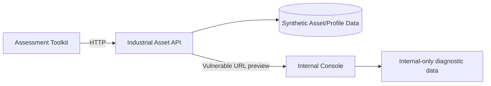

# Industrial API Security Range

A self-contained, intentionally vulnerable API security lab that simulates an industrial asset-management environment. The project demonstrates practical API security assessment, JWT abuse cases, broken object-level authorization, credential leakage, SSRF, remediation design, and automated reporting.

> **Scope:** This repository is a synthetic training environment built from scratch. It does not contain course flags, school identifiers, proprietary assignment text, or copied challenge endpoints.

## Why this project exists

This project makes common API trust-boundary failures observable in a reproducible local environment, with tests and a comparison hardened mode.

The lab includes:

- FastAPI-based industrial asset API
- Docker Compose environment with an internal-only service
- Vulnerable and hardened modes
- JWT `alg: none` acceptance flaw
- Weak HMAC signing secret
- Broken object-level authorization (IDOR/BOLA)
- Credential leakage through API content
- Server-side request forgery (SSRF)
- Python assessment toolkit
- Markdown + JSON findings reports
- Tests and GitHub Actions CI
- Threat model and remediation documentation

## Architecture



The `internal-console` service is reachable from the API container but is not published to the host. In vulnerable mode, the bookmark preview endpoint can be abused to make the API request it.

## Vulnerabilities demonstrated

| ID | Category | Demonstration | Hardened behavior |
|---|---|---|---|
| IASR-01 | Information exposure | Base64-encoded maintenance credential is returned in asset metadata | Sensitive notes are redacted |
| IASR-02 | JWT misconfiguration | API accepts unsigned `alg: none` tokens | Only HS256 is accepted |
| IASR-03 | Weak secret | Numeric JWT signing key can be brute-forced in the lab | Strong secret required |
| IASR-04 | BOLA / IDOR | Any profile can be retrieved by changing an object ID | Subject/object authorization enforced |
| IASR-05 | Broken authorization | Forged admin role reaches diagnostics | Role is trusted only after signature validation |
| IASR-06 | SSRF | URL preview reaches an internal-only service | Internal/private destinations are blocked |

## Quick start

Requirements: Docker, Docker Compose, Python 3.10+.

Start the vulnerable range:

```bash
docker compose up --build -d
```

API documentation: `http://localhost:8080/docs`

Run the automated assessment:

```bash
python3 -m venv .venv
source .venv/bin/activate
pip install -r assessor/requirements.txt
python assessor/run_all.py
```

The assessment writes `findings/report.md` and `findings/report.json`.

Stop the lab:

```bash
docker compose down
```

## Hardened mode

Use the hardened Compose override. Generate an unpredictable lab signing key for this session; do not commit that key to Git:

```bash
docker compose down
export LAB_JWT_SECRET="$(python3 -c 'import secrets; print(secrets.token_hex(32))')"
docker compose -f docker-compose.yml -f docker-compose.hardened.yml up --build -d
python assessor/run_all.py
```

The vulnerability checks should then fail safely or be reported as mitigated. This lab demonstrates URL validation, but hostname resolution and connection are separate operations; do not regard the SSRF defenses as sufficient for production without egress restrictions and address-pinned connections.

## Manual walkthrough

### 1. Obtain a normal JWT

```bash
curl -sS -X POST http://localhost:8080/api/auth/token \
  -H 'Content-Type: application/json' \
  -d '{"username":"field_tech","password":"training-only"}'
```

### 2. Inspect assets for information exposure

```bash
curl -sS http://localhost:8080/api/assets
```

### 3. Test object-level authorization

```bash
curl -sS http://localhost:8080/api/profiles/1002
```

### 4. Test the internal URL preview path

```bash
curl -sS -X POST http://localhost:8080/api/bookmarks \
  -H 'Content-Type: application/json' \
  -d '{"url":"http://internal-console:3001/secret-status"}'
```

Then retrieve the returned bookmark ID:

```bash
curl -sS http://localhost:8080/api/bookmarks/<bookmark-id>
```

## Assessment toolkit

`assessor/run_all.py` orchestrates the checks. Individual modules cover reconnaissance, credential leakage, unsigned JWTs, weak signing secrets, IDOR/BOLA, and SSRF.

Every tool is restricted to local lab targets by `assessor/common.py`.

## Security engineering value

This project demonstrates API reconnaissance, JWT analysis and validation, authentication vs. authorization, BOLA testing, SSRF threat modeling, secure URL validation, secret-management principles, Python automation, Docker networking, structured findings, and regression testing.

## Ethics and safe use

This repository is intentionally vulnerable and designed only for local, isolated training. The assessment toolkit refuses non-local targets. Do not expose vulnerable mode to the public internet.

## License

MIT
