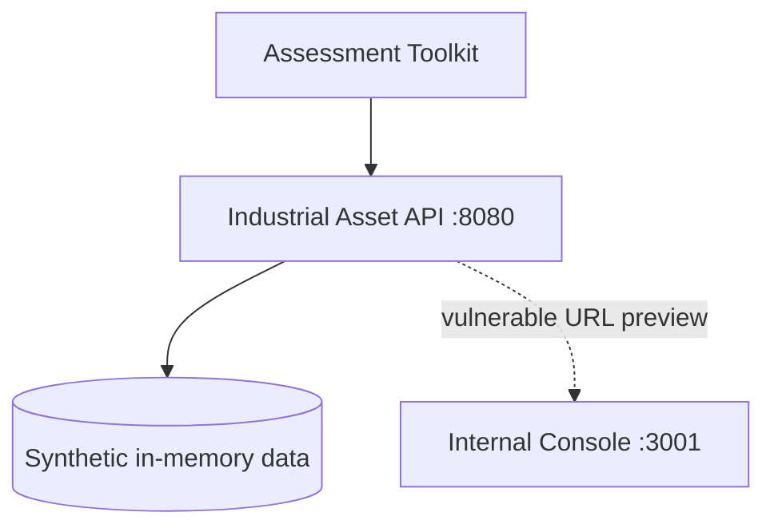

# Architecture

The range has three logical components: the public Industrial Asset API, a localhost-only Python assessment toolkit, and a Docker-network-only internal console used to demonstrate SSRF impact.

The intended trust boundary is between the public API and the internal console. Vulnerable mode intentionally violates that boundary through server-side URL fetching.
